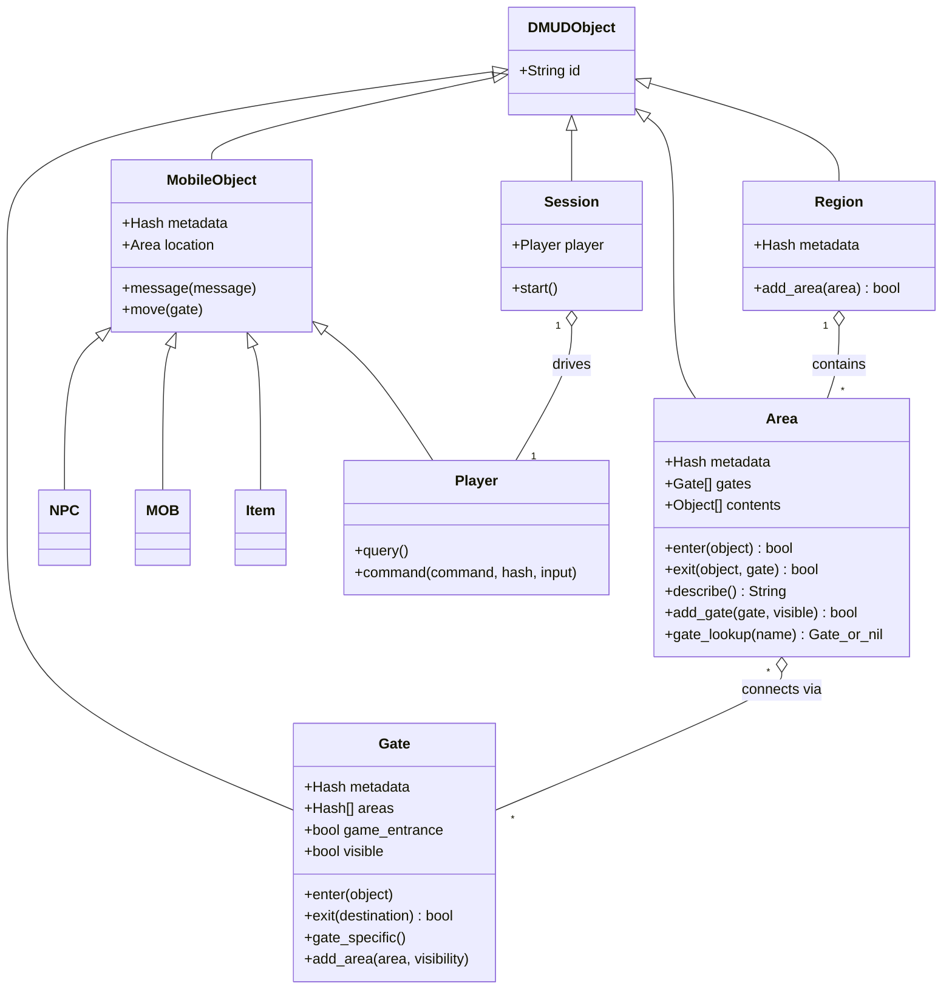
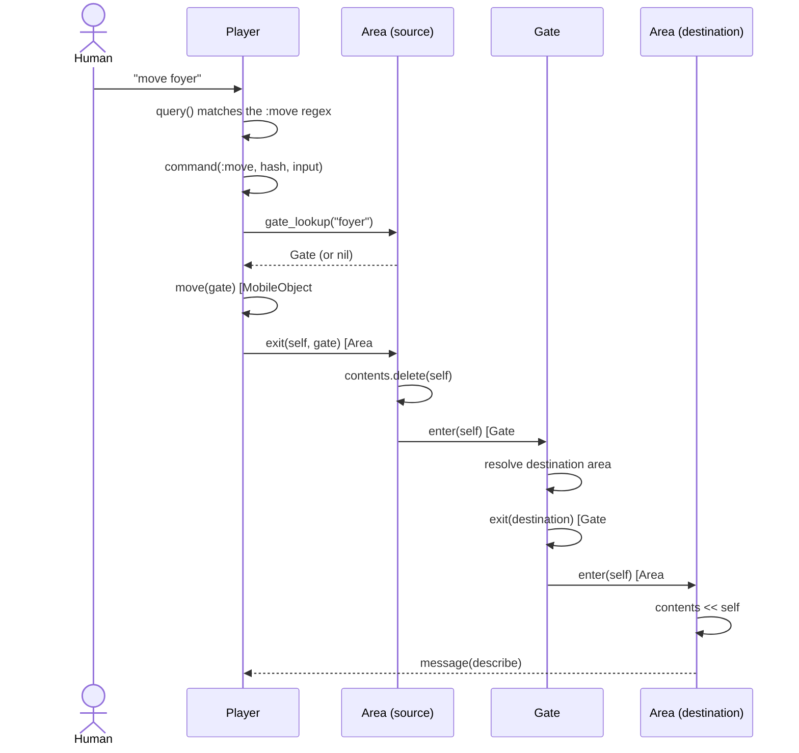
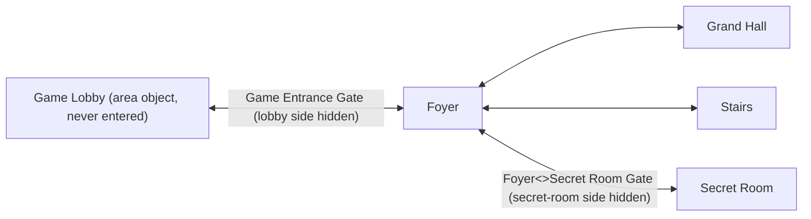

# DMUD Architecture

This document describes the classes as they exist in the code at commit `e3d2c09` on `main`. It does not describe planned behavior; anything planned is called out explicitly, and anywhere this file says a method "returns" or "raises" something, that was checked against the source or by running `test_game.rb`.

## Class hierarchy



All seven classes inherit from `DMUDObject` (directly, or via `MobileObject`). `Region` holds many `Area`s; an `Area` can be linked to many `Gate`s (and a `Gate` can link to more than one `Area`); a `Session` drives exactly one `Player`.

## DMUDObject (`class_dmud_object.rb`)

The root class. Every DMUD object is one of these, directly or by inheritance.

- **Constructor:** `initialize()` — no arguments.
- **State:** sets `@id` to `SecureRandom.uuid` (a random UUID string).
- **Public API:** `id` (reader) — returns the UUID string. That's the entire class.

## Region (`class_region.rb`)

A named container for `Area`s, for organizing a world (a server will usually have one `Region`).

- **Constructor:** `initialize(name = 'New Region', description = '')`
  - `name` (position 1, default `'New Region'`) — the region's display name.
  - `description` (position 2, default `''`) — free-text description, not currently displayed anywhere.
  - **These are positional arguments, not keyword arguments** — see [the note on constructor arguments](#a-note-on-constructor-arguments-everywhere-in-this-document) below ([#11](https://github.com/dtrammell/dmud/issues/11)).
- **State:** `@metadata` is a `Hash` with `:name` and `:description` keys; `@areas` starts as an empty array.
- **Public API:**
  - `metadata` (accessor) — the `Hash` above; read or replace it directly.
  - `add_area(area)` — appends `area` to the region's internal list and always returns `true`. There is no duplicate check (the code has a `# TODO: Check for duplicates` comment); calling it twice with the same `Area` adds it twice.

## Area (`class_area.rb`)

A single place in the game: a room, a field, a grove. Areas hold `Gate`s (exits) and `contents` (objects currently inside, including the player).

- **Constructor:** `initialize(name = 'New Area', region = nil, description = '')`
  - `name` (position 1, default `'New Area'`).
  - `region` (position 2, default `nil`) — if given, the constructor immediately calls `region.add_area(self)` so the new `Area` is registered with that `Region`. If `nil`, the area is simply not attached to any region.
  - `description` (position 3, default `''`) — shown in the room text.
  - **Positional, not keyword** ([#11](https://github.com/dtrammell/dmud/issues/11)).
- **State:** `@metadata` (`:name`, `:description`); `@proximity = :local` (set but never read by anything — presumably meant to distinguish local from remote areas in the planned distributed model; [#17](https://github.com/dtrammell/dmud/issues/17)); `@gates` and `@contents` both start as empty arrays. If `$DEBUG` is truthy, prints `"Area '<name>' (ID:<uuid>) Initialized"`.
- **Public API:**
  - `metadata`, `gates`, `contents` (accessors).
  - `enter(object)` — sets `object.location = self`, appends `object` to `@contents`, sends `object` a `message` containing `self.describe`, and returns `true`. Note it does **not** check whether `object` is already in `@contents`.
  - `exit(object, gate)` — removes `object` from `@contents` (via `Array#delete`, silently a no-op if it wasn't there), then calls `gate.enter(object)`, and returns `true`. **The object is removed from the area before the gate is asked to do anything.** If `gate.enter` raises (see `Gate` below), the object has already left its room but has not arrived anywhere else — its `location` still points at the old `Area`, and nothing rescues the exception, so the whole session crashes ([#14](https://github.com/dtrammell/dmud/issues/14)).
  - `describe` — builds and returns the room text as a `String`: unless `$DEBUG` is truthy, it prepends ANSI clear-screen and cursor-home escape codes (`\033[2J\033[H`); then `"Location: <name>"` (plus `" (ID:<uuid>)"` only if `$DEBUG`); the description; and, if `@contents` is non-empty, a list of `"  * <name> (ID:<uuid>)"` lines for everything in the area — **the per-item `(ID:...)` suffix is appended unconditionally, regardless of `$DEBUG`**, unlike the area's own ID just above it ([#3](https://github.com/dtrammell/dmud/issues/3)).
  - `add_gate(gate, visible = true)` — appends `gate` to `@gates` and calls `gate.add_area(self, visible)` so the `Gate` records this `Area` (and whether it should be listed as a visible exit — see [the Gate model](#the-gate-model) below). Returns `true`.
  - `gate_lookup(name)` — case-insensitively searches every `Gate` attached to this area, and within each gate, every `Area` that gate connects to (including this one), for a name match; returns the first matching `Gate`, or `nil` if none match. **This ignores the gate/area's `visible` flag entirely** — an area hidden from the exits list is still reachable by name if you know it ([#13](https://github.com/dtrammell/dmud/issues/13), and see below).

## Gate (`class_gate.rb`)

A link that an object passes through to travel between `Area`s — what MUD players usually call an exit.

- **Constructor:** `initialize(name = 'New Gate')` — one positional argument, not keyword ([#11](https://github.com/dtrammell/dmud/issues/11)).
- **State:** `@metadata` (`:name`, `:description` — description is never set to anything but `''` anywhere); `@game_entrance = false`; `@visible = true`; `@traversable = true` (checked by `enter`, but there is no accessor, so nothing in this codebase can ever set it to `false` — [#17](https://github.com/dtrammell/dmud/issues/17)); `@locked = false` (never read anywhere, no accessor — same issue); `@areas = []`.
- **Public API:**
  - `metadata`, `areas` (readers only); `game_entrance`, `visible` (accessors).
  - `add_area(area, visibility)` — appends `{ object: area, visible: visibility }` to `@areas`. Called by `Area#add_gate`, not usually called directly.
  - `gate_specific` — an empty hook method, meant to be overridden by a `Gate` subclass to add custom behavior during traversal (a lock check, a toll, flavor text). No subclass exists yet in this codebase.
  - `enter(object)` — the entry point for "something is walking into this gate." See the full walkthrough below; it can `raise` a plain `String` (which Ruby turns into a `RuntimeError` with that string as its message) in three cases: no connected source area, the gate not traversable, or zero configured areas.
  - `exit(destination)` — sets `object.location = destination` (using the `@object` stored by the preceding `enter` call — see the reentrancy note below), messages the object, and calls `destination.enter(object)`. Returns `true`.

### Gate#enter step by step

This is the one method worth reading in full, because several open issues live inside it.

1. Stores the incoming object in `@object` — an **instance variable on the Gate itself**, not a local variable or method argument. Because a `Gate` is a single shared object, two objects (two players, or a player and an NPC) traversing the same gate overwrite each other's `@object`, `@source_area`, and `@destination_area`. This is fine for a single-player game and unsafe the moment there's more than one simultaneous traveler ([#12](https://github.com/dtrammell/dmud/issues/12)).
2. **If `@game_entrance` is true**, unconditionally sets `object.location = @areas[0][:object]` — the *first* area that was ever linked to this gate — regardless of where the object's `location` actually was a moment ago. This is the "no source area" workaround for a brand-new connection (see [The game-entrance gate](#the-game-entrance-gate) below).
3. Searches `@areas` for an entry whose `object` equals the traveling object's (possibly just-overwritten) `location`; if none matches, sets `@source_area = nil` and raises.
4. If `@traversable` is false, messages the object and raises. `@traversable` is set to `true` in `initialize` and nothing else in the codebase ever assigns to it — there is no accessor, so no caller can set it to `false` — so this branch can never actually run today; it's dead code until something gives `Gate` a way to mark itself non-traversable ([#17](https://github.com/dtrammell/dmud/issues/17)).
5. Calls `self.gate_specific` (a no-op today) and messages `"You have entered the '<name>' Gate"`.
6. Picks a destination based on `@areas.count`:
   - **0 areas:** raises `"ERROR: This Gate has no Areas configured."`
   - **1 area (a loop):** destination = the same area you're leaving; message: `"This Gate seems to only return to the Area you're leaving..."`. Nothing in `test_game.rb` exercises this case, but the code supports it.
   - **2 areas (the normal case):** destination = whichever of the two is **not** the source area.
   - **More than 2 areas:** unimplemented — the branch is an empty `# TODO: menu for choices (@object.query)` comment. `@destination_area` is left at whatever it was from a previous traversal (or `nil` the first time), and `self.exit(@destination_area)` is then called with that stale or `nil` value, which fails with `NoMethodError` on `nil` ([#14](https://github.com/dtrammell/dmud/issues/14)). **Do not link more than two areas with one Gate today.**
7. Calls `self.exit(@destination_area)` to finish the traversal (see `Gate#exit` above).

## MobileObject (`class_movable_object.rb`)

The base class for anything with a location that exists inside an `Area`: players, NPCs, monsters, items. **The file is named `class_movable_object.rb` but the class inside it is `MobileObject`**, not `MovableObject` — use the class name, not the file name, when looking for it ([#9](https://github.com/dtrammell/dmud/issues/9)).

- **Constructor:** `initialize(name, location, description = '')`
  - `name` (position 1, **required**, no default).
  - `location` (position 2, **required**, no default) — the starting `Area`.
  - `description` (position 3, default `''`).
  - Positional, not keyword ([#11](https://github.com/dtrammell/dmud/issues/11)).
- **State:** `@metadata` (`:name`, `:description`); `@location`; `@movable = true` and `@carryable = true` — both set but never read anywhere in the codebase; moving and picking things up aren't gated on them today ([#17](https://github.com/dtrammell/dmud/issues/17)).
- **Public API:**
  - `metadata`, `location` (accessors).
  - `message(message)` — an empty no-op placeholder. `Player` overrides this to actually print something (see below); `MobileObject` itself, `NPC`, `MOB`, and `Item` silently swallow every message sent to them.
  - `move(gate)` — calls `self.location.exit(self, gate)`. This is the method a `Player`'s `move` command calls after finding a `Gate`.

### NPC, MOB, Item

Three thin subclasses at the bottom of the same file:

```ruby
class NPC < MobileObject
  def initialize
    super
    @carryable = false
  end
end

class MOB < MobileObject
  def initialize
    super
    @carryable = false
  end
end

class Item < MobileObject
  def initialize
    super
    @carryable = true
  end
end
```

**None of these three can currently be instantiated.** Each defines its own zero-argument `initialize`, and a bare `super` (no parentheses) forwards *the enclosing method's own arguments* — which is none — to `MobileObject#initialize`, which requires at least `name` and `location`. Both `NPC.new` and `NPC.new("Bob", some_area)` raise `ArgumentError` ([#1](https://github.com/dtrammell/dmud/issues/1), verified by running both forms). `test_game.rb` never creates an `NPC`, `MOB`, or `Item`, which is why this hasn't surfaced there.

## Player (`class_player.rb`)

A `MobileObject` driven by a human at a terminal: it owns the command table, the Readline prompt, and the only working `message` implementation.

- **Constructor:** `initialize(name, location, description = '')` — calls a bare `super` (forwarding its own three arguments, which works here because the arities line up), then sets `@carryable = false`, builds `@commands` (below), builds `@commandlist` (the command keys as strings, for tab completion), and configures `Readline` completion. Same positional-not-keyword note applies ([#11](https://github.com/dtrammell/dmud/issues/11)).
- **State — `@commands`:** a `Hash` of symbol → `{ type:, match:, ... }`; see [Command matching](#command-matching) below for the full table.
- **Public API:**
  - `message(message)` — overrides the no-op base version with `puts message`. This is the only place game text actually reaches the terminal; a `# TODO` comment notes this should eventually be routed to "the player's console" instead of a bare `puts`, presumably once networking exists.
  - `query` — prompts with `Readline.readline(@prompt, true)` (the `true` adds each line to Readline history), where `@prompt` is `"\n%s: Command> "` with the player's name interpolated. **The embedded `\n` inside the prompt string is not rendered correctly by Ruby's Reline-backed `Readline`: the prompt is drawn multiple times per turn and a literal backslash-n shows up in the output** — originally reported on Ruby 3.4.6 ([#6](https://github.com/dtrammell/dmud/issues/6)), and reproduced here on Ruby 4.0.5 by running `test_game.rb` with piped input. If input is `nil` (Ctrl-D / EOF), the next line calls `input.match(...)` on `nil` and raises `NoMethodError`, crashing the whole process ([#5](https://github.com/dtrammell/dmud/issues/5) — this is expected and already tracked). Otherwise, it **iterates every entry** in `@commands` (it does not stop at the first match), printing `"  MATCH!!! (...)"` or `"  No match (...)"` for each one **unconditionally, with no `$DEBUG` guard** ([#3](https://github.com/dtrammell/dmud/issues/3)), and calling `self.command(key, hash, input.chomp)` for every entry whose regex matches. Because the placeholder `:somecommand` entry's pattern is the empty regex `//` (which matches every string, including `""`), `validcommand` is always set `true` — the final `self.message "Invalid Command" if validcommand == false` line can never actually run ([#2](https://github.com/dtrammell/dmud/issues/2)).
  - `command(command, hash, input)` — dispatches on `hash[:type]`:
    - `:generic` — empty branch, does nothing. This is what runs for the always-matching `:somecommand` placeholder.
    - `:extended` — an inner `case command` with **only one branch implemented, `:move`**. `:say`, `:look`, and `:inventory` are registered and matched in `query`, but there is no branch for them here, so they silently do nothing ([#15](https://github.com/dtrammell/dmud/issues/15)).
      - `:move` extracts the area name as everything after the input's first run of non-whitespace-then-whitespace (via `input.match(/[^\s]\s(.*)/).captures[0]` — in practice, everything after the first space), looks up a `Gate` with `self.location.gate_lookup(area)`, and if found calls `self.move(gate)`; if not found, prints `"Area '<name>' not accessible from here."` and returns `false`.
    - `:custom` — an empty branch with a `# TODO` comment: a future macro system for players to register their own commands. Not implemented; no command currently uses this type.

## Session (`class_session.rb`)

Ties one `Player` to a running game loop.

- **Constructor:** `initialize(player, start_location)` — sets `@metadata` (`:name` = `'My Session'`, `:updated` = `Time.now`, `:saved` = `nil`), stores `@player = player`, sets `@player.location = start_location` (overwriting whatever location `Player.new` was given), and then immediately calls `self.start`.
- **`start` is an infinite loop, called from inside the constructor.** Because `start` never returns (short of a crash), **`Session.new` itself never returns** ([#16](https://github.com/dtrammell/dmud/issues/16)). A world file cannot hold on to the `Session` object, configure it further, run more than one, or hand control to anything else (a future server loop, for instance) after creating it — the call site in `test_game.rb` (`session = Session.new(player, lobby)`) never actually reaches the assignment until the game ends (by crashing).
- **Each turn of the loop:**
  1. Builds an `"Exits:\n"` message by walking every `Gate` attached to `@player.location`, and for every `{ object:, visible: }` entry across all of those gates' `areas` lists, appends `"  > <name>\n"` **only if that specific entry's own `visible` flag is true and its area is not the player's current location**. See [per-side visibility](#per-side-visibility) below — this is not quite "can I see across the gate from here," and it is easy to misread.
  2. Sends that message to the player.
  3. Calls `@player.query` and stores the result in a local `command` variable that is **never used** (`query`'s return value isn't meaningful either — see above).
  4. `sleep 1` — a fixed one-second pause after every single command, win or lose ([#16](https://github.com/dtrammell/dmud/issues/16)).

## The Gate model

### One-area loop

If a `Gate` has exactly one `Area` in its `areas` list, entering it sends you right back to where you started, with the message `"This Gate seems to only return to the Area you're leaving..."`. Nothing in `test_game.rb` builds one of these, but the code path exists and was read directly from `class_gate.rb`.

### Two-area normal case

The common case, used by every gate in `test_game.rb` except the entrance: two `Area`s share one `Gate`; whichever area you weren't already in becomes the destination.

### More than two areas: unimplemented

The branch exists (`when @areas.count > 2`) but its body is only a `# TODO` comment. Using one `Gate` for three or more `Area`s today leaves the destination unresolved and crashes on use ([#14](https://github.com/dtrammell/dmud/issues/14)).

### Per-side visibility

Each time an `Area` is linked to a `Gate` (via `Area#add_gate(gate, visible = true)`), that specific area-to-gate link gets its own `visible` flag, stored as `{ object: area, visible: visible }` inside the `Gate`'s `areas` array. The `Session`'s Exits display (above) only lists an area's name if **that area's own link entry** is visible — it does not matter which area you're currently standing in. In practice that means: if an area is linked with `visible: false`, its name never appears in *anyone's* Exits list, from either side of the gate, while the *other* area's name can still appear (if its own link is visible) when you're standing somewhere else connected to the same gate. **Visibility only affects the Exits list — `Area#gate_lookup` ignores it completely**, so a hidden area is still reachable the moment a player types its name ([#13](https://github.com/dtrammell/dmud/issues/13)). This is how `test_game.rb`'s Secret Room works: it is linked with `visible: false`, so "Secret Room" never shows up in the Foyer's Exits list, but `move secret room` from the Foyer still works, because `gate_lookup` finds it by name regardless.

### The game-entrance gate

A freshly created object has no previous `Area` to have exited from, so `Gate#enter` can't find a `@source_area` for it the normal way (step 3 above). The `game_entrance` flag works around this: when true, `enter` unconditionally overwrites the traveling object's `location` with `@areas[0][:object]` — **the area that was linked to this gate first** — before doing the normal source/destination resolution. In `test_game.rb` this works because `lobby.add_gate(game_entrance_gate, false)` runs *before* `foyer.add_gate(game_entrance_gate)`, so `@areas[0]` is the Lobby; a new player's location gets fudged to the Lobby, correctly resolves the Foyer as the only other option, and lands there.

This is a location workaround, not a direction check, and it has a real consequence: **the same gate keeps doing this fudge on every traversal, not just the first one.** If a player who is already in the Foyer types `move game lobby` (the gate is reachable by name via `gate_lookup` even though the Lobby side is marked invisible — see above), `enter` forces their location back to `@areas[0]` (the Lobby) regardless of the fact that they were actually in the Foyer, immediately re-resolves the Foyer as the destination, and sends them right back to the Foyer with no error or warning — they appear to "traverse the gate" but end up exactly where they started ([#13](https://github.com/dtrammell/dmud/issues/13), verified by running `move foyer` then `move game lobby` and observing the player stays in the Foyer). If your world has a one-way entrance gate like this one, do not also link it to a second, already-reachable area, or route players to it other than on first connection.

## Movement sequence



## Command matching

`Player#initialize` builds this table (reproduced from `class_player.rb`):

| Key | Type | Regex | Notes |
| --- | --- | --- | --- |
| `:move` | `:extended` | `/^m |^move |^go |^walk |^run /` | Only `:extended` branch actually implemented in `command`. Requires a trailing space after the keyword, so a bare `move`/`go`/etc. with nothing after it does not match ([#4](https://github.com/dtrammell/dmud/issues/4)). |
| `:say` | `:extended` | `/^s |^say |^talk |^yell /` | Matches, but `command` has no `:say` branch — no-op ([#15](https://github.com/dtrammell/dmud/issues/15)). |
| `:look` | `:extended` | `/^l |^look |^inspect /` | Matches, but no-op ([#15](https://github.com/dtrammell/dmud/issues/15)); also needs a trailing space, so bare `look` doesn't hit this pattern ([#4](https://github.com/dtrammell/dmud/issues/4)). |
| `:inventory` | `:extended` | `/^i |^inventory /` | Matches, but no-op ([#15](https://github.com/dtrammell/dmud/issues/15)). |
| `:somecommand` | `:generic` | `//` (empty regex) | A placeholder entry. The empty regex matches *every* string, so this entry matches on every single input, in addition to whatever else matched. `command`'s `:generic` branch is empty, so it's a no-op — but its universal match is why `validcommand` is always true and "Invalid Command" never prints ([#2](https://github.com/dtrammell/dmud/issues/2)). |

`:custom` is a third `hash[:type]` value handled in `command`, described in the code as a future home for player-registered macros; no entry in `@commands` uses it today.

Because `query` does not stop after the first match, and `:somecommand` always matches, **every valid command actually runs twice through `command`**: once for its real entry (e.g. `:move`), and once more for `:somecommand`'s empty `:generic` branch (which does nothing, so this is currently harmless, just wasted work and noisy debug output).

## The Session loop

See [Session](#session-class_sessionrb) above for the full per-turn behavior (Exits message, `query`, unused return value, `sleep 1`). The loop runs for the lifetime of the process; the only way out today is a crash (Ctrl-D, more than two areas on one gate, or any other unrescued exception from `Gate#enter`).

## The `$DEBUG` flag

`$DEBUG` is Ruby's built-in global, normally set by running `ruby -d` or `ruby --debug`. In this codebase it is checked in exactly three places:

- `Area#initialize` — prints `"Area '<name>' (ID:<uuid>) Initialized"` for every area created, only if `$DEBUG`.
- `Area#describe` — adds the clear-screen/cursor-home escape codes and omits the area's own `(ID:...)` suffix only when `$DEBUG` is **falsy** (i.e., the clear-screen is the normal, non-debug behavior); shows the area's own ID only when `$DEBUG` is **truthy**.
- `Player#query`'s `puts "Input: '%s'" % input if $DEBUG` line.

**Everything else that looks like debug output is not actually guarded by `$DEBUG` and always prints:** the `MATCH!!!`/`No match` lines in `Player#query`, and the per-item `(ID:...)` suffixes in `Area#describe`'s contents listing ([#3](https://github.com/dtrammell/dmud/issues/3)). Running with `ruby -d test_game.rb` does not turn off the always-on lines — it only adds the few that are correctly guarded.

## Example world walkthrough (`test_game.rb`)

`test_game.rb` is the only working example in the repo. It builds this map:



Built in this order:

1. `game_entrance_gate = Gate.new(name = 'Game Entrance')`, then `game_entrance_gate.game_entrance = true`.
2. `lobby = Area.new(name = 'Game Lobby')` (no region), then `lobby.add_gate(game_entrance_gate, false)` — the Lobby's side of this gate is marked **not visible**. The Lobby is only ever used as the player's starting `location` value and is never entered via `Area#enter`, so its own `describe` text is never shown.
3. `house = Region.new(name = 'House')`.
4. `foyer = Area.new(name = "Foyer", region = house, ...)`, then `foyer.add_gate(game_entrance_gate)` — the Foyer's side is visible (the default). Because the Lobby was linked to `game_entrance_gate` first, `@areas[0]` is the Lobby, which is what makes the entrance workaround land new players in the Foyer (see [The game-entrance gate](#the-game-entrance-gate)).
5. `grand_hall = Area.new(name = 'Grand Hall', region = house, ...)`, linked to the Foyer by a new two-sided `Gate` (`gate_gh_f`), both sides visible (default).
6. `stairs = Area.new(name = 'Stairs', region = house, ...)`, linked to the Foyer the same way (`gate_s_f`).
7. `secret_room = Area.new(name = 'Secret Room', region = house, ...)`, linked to the Foyer by `gate_sr_f`: the Foyer's side is visible (default), the Secret Room's side is added with `visible = false`. As described above, this hides "Secret Room" from every Exits list but does not block reaching it by name.
8. `player = Player.new(name = 'Leeroy Jenkins', location = lobby, ...)`.
9. `session = Session.new(player, lobby)` — starts the game loop immediately (see [Session](#session-class_sessionrb)); this line's left-hand assignment is never actually reached while the game is running.

Verified area-by-area reachability (by running the game and typing commands):

- From the **Game Lobby** (the player's starting location, shown as the very first Exits list): only `Foyer` is listed. Typing `move foyer` works.
- From the **Foyer**: `Grand Hall` and `Stairs` are listed (not `Secret Room`, not `Game Lobby`). `move grand hall`, `move stairs`, and `move secret room` all work; `move game lobby` also "works" in the sense that it doesn't error, but see [the game-entrance quirk](#the-game-entrance-gate) — it leaves you in the Foyer ([#13](https://github.com/dtrammell/dmud/issues/13)).
- From the **Grand Hall** and **Stairs**: only `Foyer` is listed.
- From the **Secret Room**: only `Foyer` is listed (its own link is invisible, but the Foyer's link back is visible, so the way back is shown even though the way in wasn't).

## A note on constructor arguments everywhere in this document

`test_game.rb` calls constructors like this:

```ruby
foyer = Area.new(
  name        = "Foyer",
  region      = house,
  description = 'The Foyer is large and inviting...'
)
```

This *looks* like keyword arguments, but it is not. `name = "Foyer"` is an ordinary Ruby local-variable assignment (it assigns the string to a new local variable called `name`, and the assignment expression itself evaluates to that string); the three resulting values are then passed to `Area.new` **positionally, in the order written**. It happens to work here only because the order matches `Area#initialize`'s real positional parameter order (`name, region, description`). Reordering the lines, or omitting one, silently passes the wrong value into the wrong parameter — there is no error, because the method signature has nothing to say about names. See [#11](https://github.com/dtrammell/dmud/issues/11) for the proposal to switch to real keyword arguments. Every constructor described in this document (`Region.new`, `Area.new`, `Gate.new`, `MobileObject.new`/`Player.new`, `Session.new`) is affected the same way.
