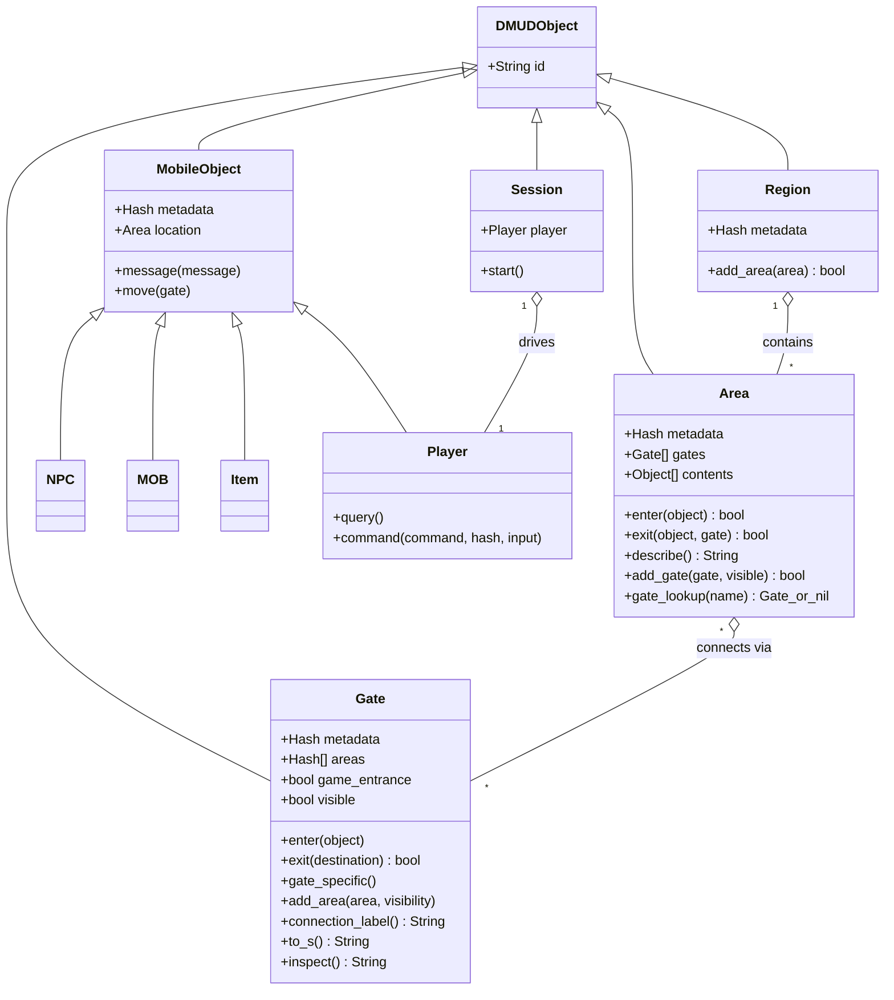
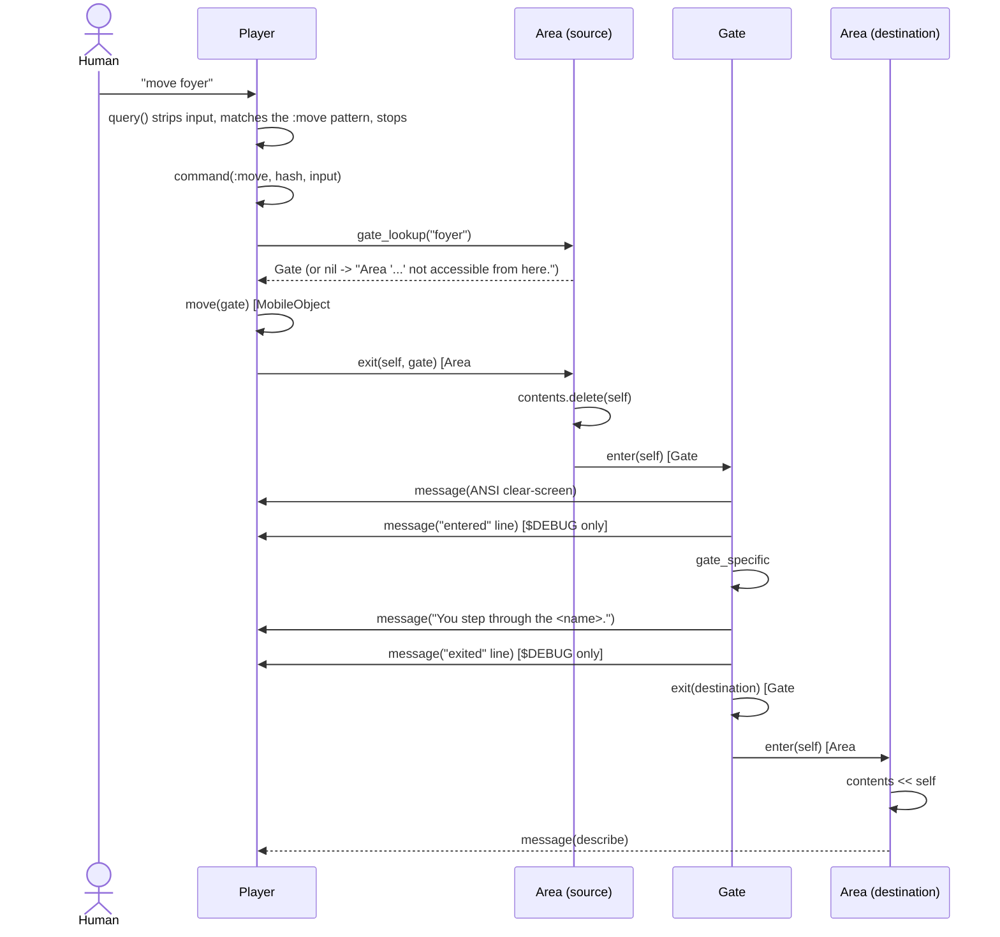
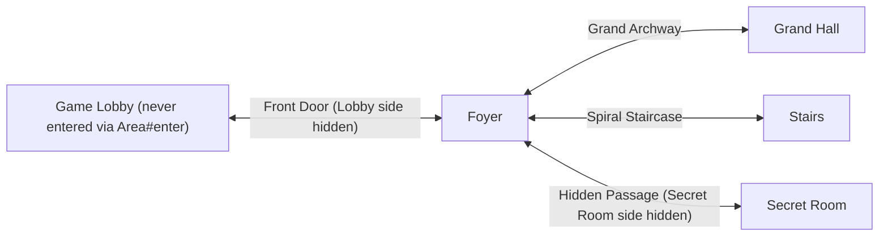

# DMUD Architecture

This document describes the classes as they exist in the code at commit
`d34cfb5ae7c51efe96d005019785497350942d42` on
`feature/issue-21-low-hanging-batch` (SE run #1502, tracked in
[#21](https://github.com/dtrammell/dmud/issues/21): a batch that fixed
#1-#9 and packaged the engine as a gem, [#20](https://github.com/dtrammell/dmud/issues/20)).
It does not describe planned behavior; anything planned is called out
explicitly, and every method's "returns"/"raises"/"prints" claim below was
checked against the source in `lib/dmud/` or by actually running
`examples/example_world.rb` and the `test/` suite.

## Class hierarchy



All seven classes inherit from `DMUDObject` (directly, or via
`MobileObject`). Each class lives in its own file under `lib/dmud/`, loaded
by `lib/dmud.rb` via `require_relative`:

| Class | File |
| --- | --- |
| `DMUDObject` | `lib/dmud/dmud_object.rb` |
| `Region` | `lib/dmud/region.rb` |
| `Area` | `lib/dmud/area.rb` |
| `Gate` | `lib/dmud/gate.rb` |
| `MobileObject`, `NPC`, `MOB`, `Item` | `lib/dmud/mobile_object.rb` |
| `Player` | `lib/dmud/player.rb` |
| `Session` | `lib/dmud/session.rb` |

**`lib/dmud/mobile_object.rb` defines the class `MobileObject`** — the file
was renamed from the old `class_movable_object.rb` to match the class name
(one class per file, file named after the class), and the class name itself
was deliberately kept as `MobileObject`, not changed to `MovableObject`.

`Region` holds many `Area`s; an `Area` can be linked to many `Gate`s (and a
`Gate` can link to more than one `Area`); a `Session` drives exactly one
`Player`.

## DMUDObject (`lib/dmud/dmud_object.rb`)

The root class. Every DMUD object is one of these, directly or by
inheritance.

- **Constructor:** `initialize()` — no arguments.
- **State:** sets `@id` to `SecureRandom.uuid` (a random UUID string).
- **Public API:** `id` (reader) — returns the UUID string. That's the entire
  class.

## Region (`lib/dmud/region.rb`)

A named container for `Area`s, for organizing a world (a server will
usually have one `Region`).

- **Constructor:** `initialize(name = 'New Region', description = '')`
  - `name` (position 1, default `'New Region'`).
  - `description` (position 2, default `''`), not currently displayed
    anywhere.
  - **Still plain positional arguments, not keyword arguments** — this batch
    didn't touch constructor signatures, and `examples/example_world.rb`
    no longer writes the misleading `name = 'Foyer'` fake-keyword style, but
    the underlying constructors are unchanged; see
    [#11](https://github.com/dtrammell/dmud/issues/11) (open).
- **State:** `@metadata` (`:name`, `:description`); `@areas` starts empty.
- **Public API:**
  - `metadata` (accessor).
  - `add_area(area)` — appends `area`, always returns `true`, no duplicate
    check (calling it twice with the same `Area` adds it twice).

## Area (`lib/dmud/area.rb`)

A single place in the game: a room, a field, a grove. Areas hold `Gate`s
(exits) and `contents` (objects currently inside, including the player).

- **Constructor:** `initialize(name = 'New Area', region = nil, description = '')`
  - `name` (position 1, default `'New Area'`).
  - `region` (position 2, default `nil`) — if given, immediately calls
    `region.add_area(self)`.
  - `description` (position 3, default `''`).
  - **Positional, not keyword** ([#11](https://github.com/dtrammell/dmud/issues/11), open).
- **State:** `@metadata`; `@proximity = :local` (set but never read by
  anything — still unused, [#17](https://github.com/dtrammell/dmud/issues/17), open);
  `@gates` and `@contents` start empty. If `$DEBUG`, prints
  `"Area '<name>' (ID:<uuid>) Initialized"`.
- **Public API:**
  - `metadata`, `gates`, `contents` (accessors).
  - `enter(object)` — sets `object.location = self`, appends to `@contents`,
    messages `object` with `self.describe`, returns `true`.
  - `exit(object, gate)` — removes `object` from `@contents`, then calls
    `gate.enter(object)`, returns `true`. The object is still removed from
    the area *before* the gate is asked to do anything, same as before this
    batch; an exception from `gate.enter` still leaves the object's
    `location` pointing at the old area while already removed from its
    contents ([#14](https://github.com/dtrammell/dmud/issues/14), open — out
    of scope for this batch).
  - `describe` — builds the room text as a `String` (now built with
    `String.new` so it's mutable even under frozen-string-literal settings).
    **The ANSI clear-screen codes that used to live here are gone** — the
    screen now clears at the *start* of a gate traversal instead (see
    [Gate#enter](#gateenter-step-by-step) below); `describe` itself just
    builds `"Location: <name>"` (plus `" (ID:<uuid>)"` only if `$DEBUG`), the
    description, and, if `@contents` is non-empty, a `"<name> contains:"`
    list with `"  * <item name>"` lines. **The per-item `(ID:...)` suffix is now
    correctly gated on `$DEBUG`** (this was a bug before this batch,
    [#3](https://github.com/dtrammell/dmud/issues/3), fixed).
  - `add_gate(gate, visible = true)` — appends `gate` to `@gates`, calls
    `gate.add_area(self, visible)`, returns `true`.
  - `gate_lookup(name)` — case-insensitively searches every `Gate` attached
    to this area, and every `Area` each of those gates connects to, for a
    name match; returns the first matching `Gate`, or `nil`. Still ignores
    the gate/area's `visible` flag entirely — an area hidden from the Exits
    list is still reachable by name ([#13](https://github.com/dtrammell/dmud/issues/13),
    open, see below).

## Gate (`lib/dmud/gate.rb`)

A link that an object passes through to travel between `Area`s.

- **Constructor:** `initialize(name = 'New Gate')` — one positional argument
  ([#11](https://github.com/dtrammell/dmud/issues/11), open).
- **State:** `@metadata`; `@game_entrance = false`; `@visible = true`;
  `@traversable = true` (checked by `enter`, but there is still no accessor,
  so nothing in this codebase can ever set it to `false` —
  [#17](https://github.com/dtrammell/dmud/issues/17), open); `@locked = false`
  (still never read, no accessor — same issue); `@areas = []`.
- **Public API:** `metadata`, `areas` (readers); `game_entrance`, `visible`
  (accessors); `add_area(area, visibility)` (appends
  `{ object: area, visible: visibility }`); `gate_specific` (empty hook for
  a subclass to add custom traversal behavior — a lock check, a toll, flavor
  text; no subclass exists in this codebase).

### Gate#enter step by step

This batch reordered and re-messaged this method (tracked as part of
[#7](https://github.com/dtrammell/dmud/issues/7) and [#19](https://github.com/dtrammell/dmud/issues/19), both now
reflected below), so every step was re-read from the current source and
re-confirmed by actually triggering a traversal with `$DEBUG` on (see the
real transcript under [Session](#session-libdmudsessionrb) below):

1. Sends the clear-screen/cursor-home ANSI codes (`\033[2J\033[H`) to the
   traveling object **first**, before anything else — this now happens at
   the *start* of the traversal rather than inside `Area#describe` (old
   bug [#7](https://github.com/dtrammell/dmud/issues/7), fixed). Clear-on-enter
   is a hardcoded interim default; making it a per-player setting is
   [#19](https://github.com/dtrammell/dmud/issues/19) (open, future work).
2. **If `@game_entrance` is true**, unconditionally overwrites the
   traveling object's `location` with `@areas[0][:object]` — the first area
   ever linked to this gate — regardless of where it actually was a moment
   ago. Unchanged mechanism; still the source of
   [#13](https://github.com/dtrammell/dmud/issues/13) (open, see below).
3. Finds `@source_area` by matching the object's (possibly just-rewritten)
   `location` against `@areas`; raises a plain `String` (a `RuntimeError`) if
   none matches.
4. If `@traversable` is false, messages and raises — still dead code,
   nothing can set `@traversable` false ([#17](https://github.com/dtrammell/dmud/issues/17)).
5. **If `$DEBUG`:** messages `"You have entered the '<name>' Gate [<connection_label>]"`
   (uses the new `connection_label` method, below).
6. Calls `self.gate_specific` (empty by default).
7. Resolves `@destination_area` from `@areas.count`: 0 raises; 1 sets the
   destination to the same area (a loop) **and messages `"This Gate seems to
   only return to the Area you're leaving..."` right here**, after
   `gate_specific` and before the step-through line; 2 picks whichever area
   isn't the source; **more than 2 is still unimplemented** — the branch is
   still an empty `# TODO`, `@destination_area` is left stale or `nil`, and
   the eventual `exit(nil)` still fails with `NoMethodError`
   ([#14](https://github.com/dtrammell/dmud/issues/14), open, confirmed by
   running the test suite's `test_three_area_gate_unsupported`).
8. **Always** messages `"You step through the <name>."` (this replaces the
   old `"You traverse the gate..."` text).
9. **If `$DEBUG`:** messages `"You have exited the '<name>' Gate [<connection_label>]"`.
10. Calls `self.exit(@destination_area)`.

`Gate#exit(destination)` is now simpler: it just sets
`@object.location = destination` and calls `destination.enter(@object)` — it
no longer sends its own message (the old `"You have exited the Gate"` text
moved into `enter`, step 9 above, and only fires under `$DEBUG` now).

`Gate` still keeps `@object`, `@source_area`, and `@destination_area` as
instance variables on the `Gate` itself rather than passing them as
arguments, so it is still not safe for two travelers through the same gate
at once ([#12](https://github.com/dtrammell/dmud/issues/12), open, out of
scope for this batch).

### Gate#connection_label, #to_s, #inspect

Three new methods, added so `$DEBUG` output and ad hoc inspection can
describe a gate's connections without a world builder writing that logic
themselves:

- `connection_label` — `'(no areas)'` if `@areas` is empty; `'<name> (loop)'`
  if there's exactly one area; otherwise every area's name, in the order
  they were added, joined by `' <> '`, with `' (hidden)'` appended to any area
  whose link was added with `visible: false`. A real run confirms the
  format: the example world's entrance gate, whose Lobby side is added
  with `visible: false` and whose Foyer side uses the default
  `visible: true`, reports itself as exactly
  `"Game Lobby (hidden) <> Foyer"`.
- `to_s` — `"<name> [<connection_label>]"`.
- `inspect` — `"#<Gate id=<id> name=<name> connections=<connection_label>>"`.

## MobileObject (`lib/dmud/mobile_object.rb`)

The base class for anything with a location inside an `Area`: players,
NPCs, monsters, items.

- **Constructor:** `initialize(name, location, description = '')` — `name`
  and `location` are still required positional arguments with no default
  ([#11](https://github.com/dtrammell/dmud/issues/11), open).
- **State:** `@metadata`; `@location`; `@movable = true` and
  `@carryable = true` — still set but never checked by anything when
  moving an object or trying to carry one
  ([#17](https://github.com/dtrammell/dmud/issues/17), open).
- **Public API:** `metadata`, `location` (accessors); `message(message)`
  (empty no-op base — `Player` is the only subclass that overrides it);
  `move(gate)` (calls `self.location.exit(self, gate)`).

### NPC, MOB, Item (fixed — #1)

```ruby
class NPC < MobileObject
	def initialize(*args)
		super(*args)
		@carryable = false
	end
end

class MOB < MobileObject
	def initialize(*args)
		super(*args)
		@carryable = false
	end
end

class Item < MobileObject
	def initialize(*args)
		super(*args)
		@carryable = true
	end
end
```

Each subclass now takes `*args` and forwards them with `super(*args)`,
instead of the old bare, zero-argument `initialize` that swallowed
whatever was passed to `.new` and called a bare `super` with nothing.
`Item.new("Sword", area)`, `NPC.new("Bob", area)`, and `MOB.new("Rat", area)`
all now succeed (confirmed by the passing `ConstructionTest` suite); the
old `ArgumentError` on construction is gone
([#1](https://github.com/dtrammell/dmud/issues/1), fixed). `carryable` is
still not an exposed constructor parameter — a 4th positional argument
still raises `ArgumentError` rather than letting a caller override it.

## Player (`lib/dmud/player.rb`)

A `MobileObject` driven by a human at a terminal.

- **Constructor:** `initialize(name, location, description = '')` — same
  signature as before, still positional
  ([#11](https://github.com/dtrammell/dmud/issues/11), open).
- **Reline, not Readline.** The file now `require`s `'reline'` and calls
  `Reline.readline` / `Reline.completion_append_character` /
  `Reline.completion_proc` directly. The old `Readline` compatibility
  module is not referenced anywhere in `lib/` or `examples/` (confirmed by
  the passing `PackagingTest#test_reline_usage_no_readline`).
- **State — command patterns:** a frozen, class-level
  `COMMAND_PATTERNS` constant (previously a per-instance `@commands` hash
  built fresh in `initialize`) with four word-boundary, case-insensitive
  regexes — see [Command matching](#command-matching) below. **The old
  `:somecommand` catch-all entry, whose empty `//` pattern matched every
  input, is gone** ([#2](https://github.com/dtrammell/dmud/issues/2), fixed).
- **Public API:**
  - `message(message)` — `puts message`, unchanged, still the only
    working `message` implementation in the class hierarchy.
  - `query` — prints a blank line with its own `puts`, **separate** from
    the prompt string (old bug [#6](https://github.com/dtrammell/dmud/issues/6),
    fixed — no more embedded `\n` inside the prompt). Then: if
    `$stdout.tty?`, reads with `Reline.readline("<name>: Command> ", true)`;
    otherwise (piped input, the common case for scripted runs), it
    `print`s the prompt itself, reads with plain `$stdin.gets`, and `puts`
    an extra newline — this avoids `Reline` erroring or misbehaving
    against a non-TTY stdin. If input is `nil` (EOF), returns `:eof` — in
    practice `Session#start` now checks `$stdin.eof?` before ever calling
    `query` (see [Session](#session-libdmudsessionrb) below), so this branch
    is a defensive fallback rather than the primary EOF path. Otherwise:
    prints `"Input: '<input>'"` if `$DEBUG` (unchanged); **strips leading
    and trailing whitespace from the input** (new,
    [#4](https://github.com/dtrammell/dmud/issues/4), fixed); then checks
    each command pattern in order and, on the first match, prints a
    `MATCH!!!` line if `$DEBUG`, dispatches via `self.command`, and
    **stops** — it no longer keeps checking every remaining pattern
    ([#2](https://github.com/dtrammell/dmud/issues/2), fixed, confirmed by a
    real debug-mode run showing exactly one `MATCH!!!` line per command).
    If nothing matched, sends `"Invalid Command"` — reachable now that
    there's no catch-all to swallow it.
  - `command(command, hash, input)` — for `:move`, extracts the area name
    with `input.sub(hash[:match], '').strip` (replacing the old
    capture-everything-after-the-first-space approach); **if the result is
    empty, sends exactly `"Move where?"` and returns `false`** (new,
    [#4](https://github.com/dtrammell/dmud/issues/4), fixed — this is what
    bare `move`/`m` now does, instead of simply failing to match at all).
    Otherwise looks up a `Gate` with `self.location.gate_lookup(area)` and
    moves there, or sends `"Area '<name>' not accessible from here."`
    (text unchanged) if none is found. `:say`, `:look`, and `:inventory` now
    have **explicit branches** in the dispatch (they used to fall through
    with no branch at all), but those branches just `return true` — they
    still produce no player-visible output
    ([#15](https://github.com/dtrammell/dmud/issues/15), open, unchanged
    user-visible behavior, confirmed by the passing `CommandsTest` suite).
    `:custom` remains an empty, unused stub for a possible future
    player-macro system.

## Session (`lib/dmud/session.rb`)

Ties one `Player` to a running game loop.

- **Constructor:** `initialize(player, start_location)` — **unchanged**:
  still calls `self.start` itself, so `Session.new` still never returns
  while the game is running
  ([#16](https://github.com/dtrammell/dmud/issues/16), open, explicitly out
  of scope for this batch).
- `start` — same per-turn Exits-message logic as before (unchanged), but
  now, before calling `@player.query`, it checks `if $stdin.eof?` and, if
  so, calls a new private `exit_cleanly` method and returns instead of
  calling `query` on exhausted input (old crash,
  [#5](https://github.com/dtrammell/dmud/issues/5), fixed for the EOF
  path). The whole loop is wrapped in `rescue Interrupt => e`, which also
  calls `exit_cleanly` (fixed for the Ctrl-C path). `sleep 1` after every
  turn is still present, unchanged.
- `exit_cleanly(reason: nil, exception: nil)` (new, private): if `$DEBUG`,
  prints the EOF `reason` text plus Ruby's own `caller` backtrace (there's
  no exception object for EOF), or the `exception`'s class/message plus
  its real `.backtrace` (for `Interrupt`), followed by the session name,
  the player name, and the player's current location name. **Then,
  always, regardless of `$DEBUG`**, prints `"Farewell, <player name>."` and
  calls `exit 0`.

A real `$DEBUG`-on run (`ruby -d -Ilib examples/example_world.rb`, one
`move foyer` command, then EOF) shows the exact order described above:

```
EOF (end of input)
/home/nova/dmud/lib/dmud/session.rb:46:in 'block in Session#start'
/home/nova/dmud/lib/dmud/session.rb:32:in 'Kernel#loop'
/home/nova/dmud/lib/dmud/session.rb:32:in 'Session#start'
/home/nova/dmud/lib/dmud/session.rb:25:in 'Session#initialize'
examples/example_world.rb:75:in '<main>'
Session: My Session
Player:  Leeroy Jenkins
Location: Foyer
Farewell, Leeroy Jenkins.
```

Both the EOF path and the `Interrupt`/Ctrl-C path were also directly
re-confirmed by the passing `ExitTest` suite, which spawns the example
world as a real subprocess and sends it an actual EOF or `SIGINT`.

## The Gate model

### One-area loop

Unchanged mechanism: a `Gate` with exactly one linked `Area` sends you
back to where you started, now with the loop message printed between
`gate_specific` and the step-through line (see step 7 above). Nothing in
`examples/example_world.rb` builds one of these.

### Two-area normal case

Unchanged: the common case, used by every gate in the example world except
the entrance; whichever area you weren't already in becomes the
destination.

### More than two areas: still unimplemented

Still an empty `# TODO` branch; still crashes with `NoMethodError` on use
([#14](https://github.com/dtrammell/dmud/issues/14), open, out of scope
for this batch, confirmed still broken by the passing
`test_three_area_gate_unsupported` test, which expects exactly that
error).

### Per-side visibility

Unchanged mechanism: each time an `Area` is linked to a `Gate` (via
`Area#add_gate(gate, visible = true)`), that specific area-to-gate link
gets its own `visible` flag. The Exits list only names an area if **that
area's own link entry** is visible — it does not matter which area you're
currently standing in. A link added with `visible: false` never appears
in *anyone's* Exits list, while the *other* end of the same gate can still
appear from elsewhere if its own link is visible. `Area#gate_lookup`
ignores this flag entirely, so a hidden area is still reachable by name
([#13](https://github.com/dtrammell/dmud/issues/13), open). This is how the
Secret Room works: its link is `visible: false`, so it never appears in
the Foyer's Exits list, but `move secret room` from the Foyer still works
(confirmed by a real run — see the transcript in the
[README](../README.md#commands-you-can-type-today)).

### The game-entrance gate ("Front Door")

The example world's entrance gate is now named `"Front Door"` (it was
`"Game Entrance"` before this batch; the *area* names — Game Lobby, Foyer,
Grand Hall, Stairs, Secret Room — are unchanged). The mechanism is
unchanged: because a freshly created object has no previous `Area` to
have exited from, `Gate#enter`'s `game_entrance` branch unconditionally
overwrites the traveling object's `location` with `@areas[0][:object]` —
the Lobby, since it's linked to this gate before the Foyer is — before
resolving a destination. This still means the same gate re-fudges the
location on *every* traversal, not just the first: a player standing in
the Foyer who issues `move game lobby` still gets routed back to the
Foyer, with no error, because entering the gate first forces their
location to the Lobby and then immediately resolves the only other linked
area (the Foyer) as the destination
([#13](https://github.com/dtrammell/dmud/issues/13), open, confirmed still
present by the passing `test_entrance_round_trip_unchanged` and
`test_move_foyer_while_in_foyer` tests). If your world has an entrance gate
like this one, don't also link it to a second, already-reachable area, or
route players to it other than on first connection.

## Movement sequence



## Command matching

`Player::COMMAND_PATTERNS` (`lib/dmud/player.rb`):

| Key | Type | Regex | Notes |
| --- | --- | --- | --- |
| `:move` | `:extended` | `/^(m\|move\|go\|walk\|run)\b/i` | Case-insensitive, word-boundary. Bare `move`/`m`/etc. with nothing after it matches and prints exactly `"Move where?"`. |
| `:say` | `:extended` | `/^(s\|say\|talk\|yell)\b/i` | Matches (including bare `say`), but `command`'s `:say` branch is a no-op ([#15](https://github.com/dtrammell/dmud/issues/15), open). |
| `:look` | `:extended` | `/^(l\|look\|inspect)\b/i` | Matches (including bare `look`), still a no-op ([#15](https://github.com/dtrammell/dmud/issues/15), open). |
| `:inventory` | `:extended` | `/^(i\|inventory)\b/i` | Matches (including bare `i`), still a no-op ([#15](https://github.com/dtrammell/dmud/issues/15), open). |

The word-boundary (`\b`) means `lookout`, `items`, and `moved` do **not**
match their respective commands and fall through to `"Invalid Command"`
instead. **There is no more catch-all entry** — the old `:somecommand`
placeholder with the empty `//` pattern is gone
([#2](https://github.com/dtrammell/dmud/issues/2), fixed) — and `query`
now stops checking after the first match, so a command is dispatched at
most once per input, never twice. `:custom` is still a third
`hash[:type]` value handled (as an empty stub) in `command`, for a possible
future player-macro system; no entry in `COMMAND_PATTERNS` uses it.

## The Session loop

See [Session](#session-libdmudsessionrb) above for the full per-turn
behavior. `Session.new` still never returns while the game runs
([#16](https://github.com/dtrammell/dmud/issues/16), open), and the loop
still sleeps one second after every turn. The loop now exits cleanly
(status `0`, a goodbye message) on EOF or Ctrl-C instead of crashing.

## The `$DEBUG` flag

Counting directly from the current source, `$DEBUG` is checked in eight
places:

1. `Area#initialize` — the `"Area '<name>' (ID:<uuid>) Initialized"` line
   (unchanged from before this batch).
2. `Area#describe` — the area's own `(ID:<uuid>)` suffix after
   `"Location: <name>"` (unchanged, already correct before this batch).
3. `Area#describe` — the per-item `(ID:<uuid>)` suffix in the contents
   listing. **This used to print unconditionally; it's now correctly
   gated** ([#3](https://github.com/dtrammell/dmud/issues/3), fixed).
4. `Player#query` — the `"Input: '<input>'"` line (unchanged, already
   correct before this batch).
5. `Player#query` — the `MATCH!!!` line printed on a successful match.
   **This used to print unconditionally (there was no guard at all); it's
   now correctly gated** ([#3](https://github.com/dtrammell/dmud/issues/3),
   fixed).
6. `Gate#enter` — the `"You have entered the '<name>' Gate [...]"` line
   (new this batch).
7. `Gate#enter` — the `"You have exited the '<name>' Gate [...]"` line
   (new this batch).
8. `Session#exit_cleanly` — the whole EOF/Interrupt debug dump (reason or
   exception, backtrace, session/player/location state) that prints before
   the always-on goodbye line (new this batch, part of
   [#5](https://github.com/dtrammell/dmud/issues/5)'s fix).

Running with `ruby -d` (or setting `$DEBUG = true` directly) turns on all
eight. Everything that used to print regardless of `$DEBUG` (items 3 and 5
above) is fixed; there is no longer a known always-on debug leak in this
codebase.

## Example world walkthrough (`examples/example_world.rb`)

`examples/example_world.rb` is the only example in the repo, run with
`ruby -Ilib examples/example_world.rb` (development) or directly once the
gem is installed and a copy of the script is available (it is not shipped
inside the installed gem itself — see the
[README](../README.md#as-an-installed-gem)). It builds the same five-area
house as the old `test_game.rb`, with plain positional constructor calls
(no more `name = "Foyer"` fake-keyword style) and new, player-facing gate
names:



| Link | Gate name (was, before this batch) |
| --- | --- |
| Game Lobby <-> Foyer | `Front Door` (`Game Entrance`) |
| Foyer <-> Grand Hall | `Grand Archway` (`Foyer<>Grand Hall Gate`) |
| Foyer <-> Stairs | `Spiral Staircase` (`Foyer<>Stairs Gate`) |
| Foyer <-> Secret Room | `Hidden Passage` (`Foyer<>Secret Room Gate`) |

Area names and the player name (`"Leeroy Jenkins"`) are unchanged. Build
order is unchanged too: the entrance gate is linked to the Lobby (hidden
side) before the Foyer (visible side), which is what makes the Lobby the
gate's `@areas[0]` and makes the entrance workaround land new players in
the Foyer (see [above](#the-game-entrance-gate-front-door)).

Verified by running the example world directly: from the Lobby (the
player's starting location), only `Foyer` is listed as an exit, and
`move foyer` works, stepping through the Front Door. From the Foyer,
`Grand Hall` and `Stairs` are listed (not `Secret Room`, not `Game Lobby`);
`move secret room` still works despite not being listed, stepping through
the Hidden Passage. `look` and `say hi` produce no visible output at all
at any point (confirmed [#15](https://github.com/dtrammell/dmud/issues/15)
is still open). An unrecognized command (`xyzzy`) now prints exactly
`"Invalid Command"`. See the full transcript in the
[README](../README.md#commands-you-can-type-today).

## A note on constructor arguments

`examples/example_world.rb` no longer writes the misleading
`name = "Foyer"` style that the original `test_game.rb` used — calls are now
plain, ordinary positional arguments, e.g.
`Area.new('Foyer', house, 'The Foyer is large and inviting...')`. That's a
readability improvement, but it doesn't change the underlying issue: the
constructors themselves (`Region.new`, `Area.new`, `Gate.new`,
`MobileObject.new` and its subclasses, `Session.new`) still take plain
positional arguments, not real Ruby keyword arguments, so argument order
still matters and getting it wrong still fails silently rather than
raising. See [#11](https://github.com/dtrammell/dmud/issues/11) (open) for
the proposal to switch to real keyword arguments.
